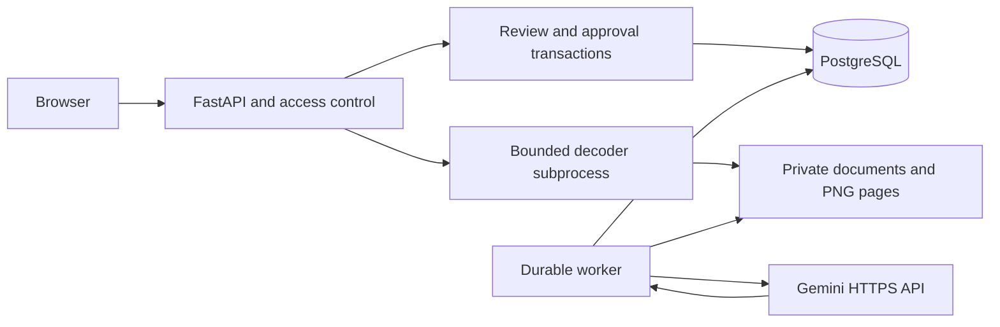

# Architecture decisions and invariants

## Modular monolith

The HTTP API (`app/main.py`), business transactions (`app/services.py`), access control (`app/security.py`), provider adapter (`app/ai.py`) and worker (`app/worker.py`) are separate modules in one deployable codebase. A worker process runs independently so slow cloud calls do not hold request transactions open. This avoids adding Redis, event brokers and multiple services before scale justifies them.

## Financial integrity

Every transition locks the invoice and checks an expected version. Approval also locks PO lines in stable UUID order, then rechecks cumulative allocations under PostgreSQL READ COMMITTED. Another approval waiting for the same lines sees committed allocations before proceeding. All allocations, status changes and audit entries commit together. Review values use Decimal; line totals round HALF_UP to two decimal places. Approval cannot occur if the actor uploaded or last reviewed the invoice. Admin does not bypass this rule.

Original bytes have SHA256 uniqueness. Supplier plus whitespace-normalized uppercase invoice number has a database uniqueness constraint. Saving a duplicate rolls back the entire review transaction. This is exact duplicate detection, not a promise of fuzzy fraud detection. Export locks the invoice and persists one immutable CSV record; subsequent requests return that same record.

## Jobs and AI

A worker claims one job using `FOR UPDATE SKIP LOCKED`, assigns a random lease token and commits before calling Google. The three-minute lease exceeds the ordinary 55-second response read timeout. Expired jobs can be reclaimed; completion checks ownership and unexpired lease time so a delayed former owner cannot commit, even before reclamation. Temporary transport, HTTP 408/429 and HTTP 5xx failures receive at most three attempts, separated by 30/60-second backoff. Invalid credentials, request rejection, invalid output and oversized responses fail without repeated paid calls. Exhausted crash recovery records an audit event once. A crash after a provider request can cause another paid request after lease expiry: delivery is at least once, not exactly once.

Gemini output is validated with Pydantic after schema-constrained generation. Monetary suggestions are requested as decimal strings. Missing quantities, prices, tax, discount, dates and currency can remain null in suggestions, but required reviewed fields cannot remain missing. The UI preserves unknown values as blank fields rather than silently defaulting tax or currency. The provider does not accept custom sampling parameters on the configured model; no temperature override is sent. The UI never silently replaces a saved review with an extraction result. The operator must adopt a draft explicitly and map supplier/PO lines. Evidence snippets are unverified model suggestions, not authenticated citations.

Login fails closed if JavaScript initialization fails: the submit button starts disabled, is enabled only after handlers register, and the form has a POST-only fallback. The module MIME type is explicit to avoid Windows registry mappings serving JavaScript as text/plain. Password reset is an administrator CLI operation generating a random replacement and revoking existing sessions.

## Scope and tradeoffs

Same-origin vanilla modules keep this finite review workflow straightforward and avoid token storage in the browser. A larger collaborative editor may justify TypeScript/React; neither additional frameworks nor microservices establish reliability by themselves. File decoding runs out of process with bounds, but stronger OS isolation and malware inspection are production hardening work. The API and worker currently run under the same Windows account and share a least-privilege DB role; this is a code boundary, not isolation from a compromised process.

## References

- PostgreSQL queue locking: https://www.postgresql.org/docs/current/sql-select.html
- Gemini document processing: https://ai.google.dev/gemini-api/docs/document-processing
- Gemini structured output: https://ai.google.dev/gemini-api/docs/structured-output
- Gemini model parameters: https://docs.cloud.google.com/gemini-enterprise-agent-platform/models/gemini/3-5-flash-lite
- OWASP file uploads: https://cheatsheetseries.owasp.org/cheatsheets/File_Upload_Cheat_Sheet.html

## Integration boundary (API v1)

One organization per deployment/database; integration connections are source
namespaces, not tenants. Staff sessions retain CSRF/origin protection. Machine
routes require a hashed, scoped, expiring bearer key and reject browser origins
and session cookies. Admins alone manage connections, mapping and secret rotation.

Imported records are scoped by connection/type/external ID, serialized with the
connection row lock, validated transactionally and immutable after creation.
Replays with matching content return the existing ID; conflicting replays cannot
overwrite purchasing references. Dry runs roll back all writes. Approved invoice
reads join the connection's imported PO mapping to prevent cross-source disclosure.

Invoice audit transactions enqueue webhook events. A PostgreSQL outbox worker
uses SKIP LOCKED, leases, tokens, bounded retries and safe status/error reporting.
Delivery is at least once and requires receiver deduplication. HMAC covers attempt
timestamp and exact body. HTTPS destinations are checked and pinned to a public
IPv4 address with hostname verification; no redirects/private destinations/proxies.
Webhooks contain IDs and event type, not full financial data. The receiving backend
uses its scoped key to fetch approved invoice data. See integrations.md for limits.
